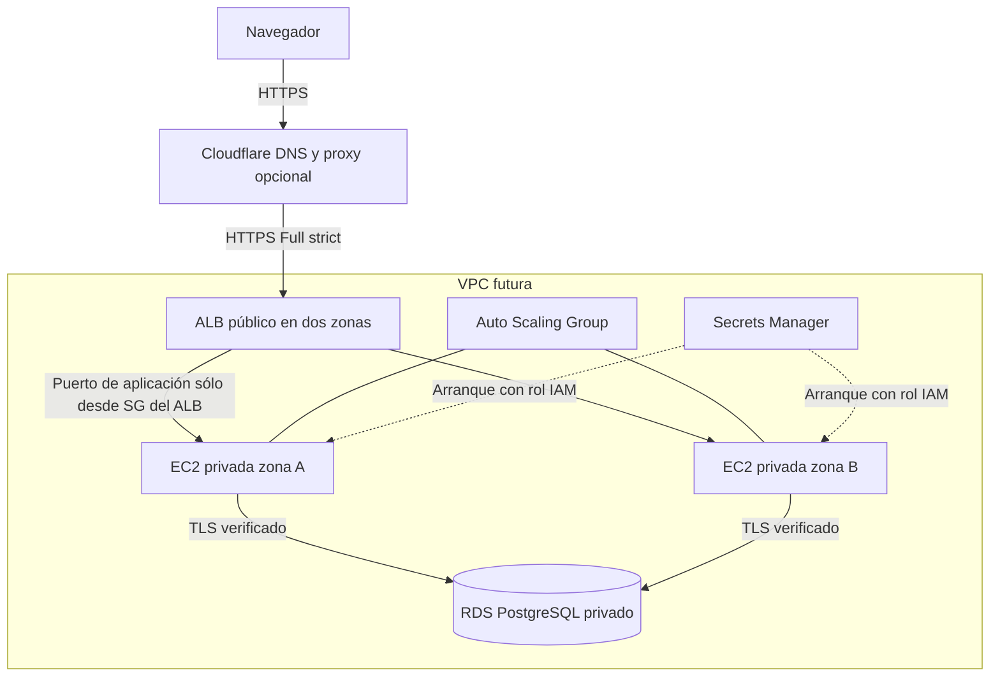

# EVA 3: preparación de producción y despliegue AWS

Preparación documental revisada el 16-11-2026 para `feature/fullstack-mvc`. **No se ejecutó ningún despliegue AWS/Cloudflare, no se crearon recursos, DNS ni certificados y no se validó una conexión a RDS.** La aprobación futura debe definir cuenta, región, presupuesto, dominio, infraestructura, secretos y ventana de cambio. Los valores reales no se inventan ni se incorporan al repositorio.

El estado local y las pruebas finales se registran en [EVA3-estado-final.md](EVA3-estado-final.md). [EVA3-arquitectura.md](EVA3-arquitectura.md) y [EVA3-api.md](EVA3-api.md) describen el comportamiento implementado.

## Qué está preparado y qué falta

| Área | Implementado | Falta validar o construir en fase AWS |
| --- | --- | --- |
| React | Build Vite servido por Express | Navegador contra dominio y proxy reales |
| Contenedor | Node 24, etapas build/runtime, usuario `node`, health check y Compose separado para DB externa | Registro remoto, digest de release y arranque gestionado en EC2 |
| PostgreSQL externo | `DATABASE_URL`, `DB_SSL=verify-full`, validación de certificado activada | RDS privado, CA montada, TLS y hostname reales, roles DB y restauración |
| Sesiones | Token opaco e intentos de login en PostgreSQL | Prueba entre dos instancias y limpieza periódica de expirados |
| Fotografías | Archivos existentes dentro de la imagen; asociación validada | Sólo si se solicita upload: nueva API y almacenamiento compartido |
| Secretos | Lectura de variables de proceso | Obtención segura de Secrets Manager, rotación e integración de arranque |
| Proxy | Cookie `Secure` en `APP_ENV=prod`; CSRF por host/cabecera | Confianza de proxy/IP, host preservado y pruebas de cabeceras |
| Observabilidad | Salud y mensajes genéricos en stdout/stderr | CloudWatch, access logs, alarmas, retención y correlación |
| Infraestructura | Diseño, checklist y `compose.production.yaml` para contenedores | Plantillas EC2, ALB, ASG, RDS y Cloudflare; sin ejecutar |

`compose.yaml` y `scripts/stack.mjs` son automatización local, no un despliegue RDS. Compose fija PostgreSQL `db`, credenciales del servicio local y `DB_SSL=disable`. Al exigir TLS para `APP_ENV=prod`, ese Compose no cumple el contrato productivo. La plantilla `infrastructure/env/prod.env.example` sigue siendo orientativa; no suministra recursos ni secretos y no monta un certificado.

El nuevo `compose.production.yaml` sí prepara contenedores para una DB externa, sin servicio PostgreSQL, `build` ni migraciones implícitas. `scripts/stack.mjs up prod` se rechaza antes de leer credenciales o ejecutar Docker para impedir confundirlo con el Compose local. No se cambiaron los archivos `.env` existentes.

## Topología propuesta



Propuesta: ALB en subredes públicas de al menos dos zonas, EC2 sin IP pública en subredes privadas y RDS sin acceso público. El grupo de subredes RDS debe cubrir las zonas acordadas; Multi-AZ y retención se decidirán según disponibilidad y presupuesto. [AWS describe el acceso privado y los grupos de subredes de RDS](https://docs.aws.amazon.com/AmazonRDS/latest/UserGuide/USER_VPC.WorkingWithRDSInstanceinaVPC.html).

| Grupo conceptual, sin ID asignado | Entrada prevista | Salida necesaria |
| --- | --- | --- |
| ALB | 443 desde los clientes autorizados; si Cloudflare será el único ingreso, rangos oficiales vigentes de Cloudflare. 80 sólo si se decide redirigir a HTTPS | Puerto de aplicación y salud hacia SG de EC2 |
| EC2 aplicación | Puerto de aplicación únicamente desde SG de ALB; sin SSH público | 5432 hacia SG de RDS y HTTPS hacia servicios autorizados de imagen, secretos y logs |
| RDS | 5432 únicamente desde SG de aplicación y del trabajo migrador autorizado | Lo requerido por la política de red aprobada |

El puerto interno actual es 3000, configurable con `PORT`. Hay que publicar ese puerto desde el contenedor al host privado para el target del ALB o definir un proxy local; la publicación loopback de Compose no es accesible desde ALB. [AWS recomienda restringir los targets al SG del balanceador y permitir también el puerto de salud](https://docs.aws.amazon.com/elasticloadbalancing/latest/application/load-balancer-update-security-groups.html). [Los SG de RDS admiten como origen otro SG](https://docs.aws.amazon.com/AmazonRDS/latest/UserGuide/Overview.RDSSecurityGroups.html).

Definir acceso administrativo por Session Manager o canal privado aprobado y la salida de las subredes privadas mediante endpoints VPC/NAT según necesidad. El acceso privado a RDS no se resuelve publicándolo para facilitar una migración.

## Variables reales del contrato

| Nombre exacto | Lectura/efecto actual | Producción futura |
| --- | --- | --- |
| `APP_ENV` | `dev`, `qa`, `prod`; por defecto `dev` | `prod` explícito; habilita cookie `Secure` y exige TLS DB |
| `NODE_ENV` | `development`, `test`, `production`; validado | `production` obligatorio con `APP_ENV=prod`; Dockerfile ya lo fija |
| `PORT` | Entero 1–65535; por defecto 3000 | Alinear contenedor, host privado, target group y salud |
| `DATABASE_URL` | URL `postgres:`/`postgresql:` con host y nombre DB; requerida | Host DNS real de RDS y DB/usuario autorizados; sin parámetros SSL en la query |
| `DB_SSL` | Sólo `disable` o `verify-full`; por defecto `disable` | `verify-full` obligatorio; produce `ssl: { rejectUnauthorized: true }` |
| `PGUSER`, `PGPASSWORD` | `pg` usa estos valores cuando no quedan resueltos por la URL | Soportados por el driver; el manifiesto productivo actual no los pasa al contenedor |
| `PGHOST`, `PGPORT`, `PGDATABASE` | Valores estándar de `pg` cuando la URL no los resuelve; Compose local los utiliza | No se propagan en el manifiesto productivo; la URL debe señalar explícitamente RDS |
| `NODE_EXTRA_CA_CERTS` | Variable del runtime Node; extiende las CA confiables al arrancar | Ruta absoluta a bundle PEM oficial de RDS, montado de sólo lectura y legible por `node` |

`DATABASE_URL` sigue siendo obligatoria aunque se utilicen variables `PG*`. [node-postgres documenta las variables estándar y la configuración por URI](https://node-postgres.com/features/connecting). El manifiesto productivo actual sólo transmite `DATABASE_URL`: requiere la URL completa como secreto de runtime, con caracteres de usuario/contraseña codificados correctamente. Separar la contraseña en `PGPASSWORD` requeriría ampliar y validar ese manifiesto; definirla sólo en el host no la propaga automáticamente.

No existen `DB_SSL_CA`, `DB_CA_CERT`, `TRUST_PROXY`, `SESSION_SECRET`, `S3_BUCKET`, `AWS_SECRET_ARN` ni un lector automático de archivos `*_FILE` en la aplicación. Tampoco existe una variable de URL pública de API para React: se usa el mismo origen. Agregar nombres de variables al entorno no implementa esas funciones.

`POSTGRES_DB`, `POSTGRES_USER`, `POSTGRES_PASSWORD` y `DB_PORT` pertenecen al PostgreSQL/Compose local, no al contrato de aprovisionamiento RDS. El código no usa AWS SDK ni un proveedor de tokens IAM de RDS; un rol IAM EC2 no reemplaza por sí solo las credenciales PostgreSQL de esta implementación.

### Contrato de `compose.production.yaml`

| Variable de interpolación Compose | Contrato exacto |
| --- | --- |
| `APP_IMAGE` | Obligatoria: imagen existente, exactamente la validada en QA; en registro remoto usar digest inmutable |
| `DATABASE_URL` | Obligatoria: secreto de conexión de la identidad adecuada para cada trabajo; nunca imprimir `docker compose config` expandido con el secreto real |
| `RDS_CA_BUNDLE` | Obligatoria: archivo PEM existente fuera del repositorio, montado de sólo lectura en `/run/certs/rds-ca.pem` |
| `BIND_ADDRESS` | Sólo backend; por defecto `127.0.0.1`. Para ALB, IP privada de EC2 explícita y SG restrictivo |
| `PORT` | Puerto del host publicado, por defecto 3000. El puerto interno del contenedor queda fijo en 3000 |

El manifiesto fija `APP_ENV=prod`, `NODE_ENV=production`, `DB_SSL=verify-full`, `PORT=3000` interno y `NODE_EXTRA_CA_CERTS=/run/certs/rds-ca.pem`. Exige presencia de las variables obligatorias, pero no verifica que `APP_IMAGE` sea un digest ni que haya aprobado QA: eso debe comprobarse con la evidencia de release. El bind de CA usa `create_host_path:false` para no crear un directorio si falta la ruta; aún se debe comprobar que sea un PEM legible por `node`. [Referencia oficial del montaje bind en Compose](https://docs.docker.com/reference/compose-file/services/#volumes).

Backend utiliza `init:true`, reinicio `unless-stopped`, logs locales rotados con `max-size:10m` y `max-file:3` y no depende del migrador. Ambos servicios tienen raíz de sólo lectura, `/tmp` temporal, todas las capabilities eliminadas y `no-new-privileges`. La rotación local de logs no es envío a CloudWatch.

`migrate` sólo se incluye con el perfil `maintenance`, ejecuta `node database/run.js migrate`, carece de puertos publicados y desactiva HEALTHCHECK. Usa la misma imagen/configuración estructural del backend, pero se le debe inyectar la credencial migradora en su ejecución independiente. No dejar esa URL privilegiada en el arranque posterior de backend.

## TLS hacia RDS

1. Obtener el endpoint DNS verdadero de RDS y la CA apropiada desde la fuente oficial; no sustituirlo por una IP o alias no cubierto por el certificado.
2. Preparar un bundle PEM oficial de RDS, validar procedencia/integridad, registrar su versión/rotación y montarlo de sólo lectura en todos los contenedores de aplicación y migración.
3. Configurar `DB_SSL=verify-full` y `NODE_EXTRA_CA_CERTS` **antes** de iniciar Node. La opción actual valida la cadena y, usando el hostname de conexión, la identidad del servidor. No usar `rejectUnauthorized:false` ni `NODE_TLS_REJECT_UNAUTHORIZED=0`.
4. No añadir `sslmode`, `sslrootcert`, `sslcert` u otro parámetro cuyo nombre incluya `ssl` a `DATABASE_URL`: `loadConfig` lo rechaza. [node-postgres advierte que las opciones SSL en la URL pueden sustituir el objeto `ssl`](https://node-postgres.com/features/ssl).
5. En la futura prueba aislada verificar conexión correcta con CA válida, rechazo con CA/hostname no válidos y rechazo sin TLS cuando se imponga en RDS. Consultar `pg_stat_ssl` para la conexión del cliente; un HTTP 200 no prueba por sí solo que haya TLS.

[AWS publica los bundles y explica la verificación de identidad](https://docs.aws.amazon.com/AmazonRDS/latest/UserGuide/UsingWithRDS.SSL.html). Para RDS PostgreSQL se debe comprobar y exigir `rds.force_ssl=1`; AWS documenta ese comportamiento y el uso de certificados en [la guía SSL de PostgreSQL](https://docs.aws.amazon.com/AmazonRDS/latest/UserGuide/PostgreSQL.Concepts.General.SSL.html).

La vía `NODE_EXTRA_CA_CERTS` no requiere inventar una variable de aplicación ni reconstruir con secretos. Node la lee al iniciarse; cambiar `process.env` después no actualiza la confianza. Un PEM ausente/malformado puede producir sólo un aviso de Node: el procedimiento debe verificar que se montó y comprobar el handshake. [Contrato oficial de Node 24](https://nodejs.org/download/release/v24.11.1/docs/api/cli.html#node_extra_ca_certsfile). **Estas comprobaciones contra RDS siguen pendientes.**

## Secretos y permisos

La aplicación recibe variables; todavía no descarga secretos. Una fase futura debe implementar el arranque que obtiene el secreto, lo inyecta al proceso/contenedor sin imprimirlo y reinicia de forma controlada cuando se rota. No guardar valores en Git, imágenes, argumentos, user-data en claro, historial de comandos, logs, plantillas compartidas ni artefactos QA. El bundle CA es público; las contraseñas y tokens no lo son.

Asignar un instance profile IAM con permisos mínimos para leer únicamente los secretos necesarios, descifrar con la clave correspondiente si se usa KMS, descargar la imagen autorizada y emitir logs. Separar privilegios de despliegue y migración; no entregar permisos administrativos AWS al backend. [AWS recomienda roles EC2 con credenciales temporales y políticas de mínimo privilegio](https://docs.aws.amazon.com/AWSEC2/latest/UserGuide/iam-roles-for-amazon-ec2.html); [Secrets Manager ofrece mecanismos de recuperación](https://docs.aws.amazon.com/secretsmanager/latest/userguide/retrieving-secrets.html), pero ninguno está integrado aquí todavía.

Separar también identidades PostgreSQL:

- Migrador: permisos DDL sobre el esquema y gestión del historial; credencial disponible sólo para el trabajo de release autorizado.
- Aplicación: conexión, uso del esquema, SELECT/INSERT/UPDATE/DELETE que realmente necesitan catálogo, usuarios, sesiones, comentarios y asignaciones, y uso de secuencias de identidad; sin crear/borrar tablas, sin propietario/superusuario y sin credencial maestra de RDS.

El borrado SQL de sesiones/asignaciones es funcional y no implica permiso DDL. Definir GRANT/default privileges con el dueño/migrador para que futuras tablas y secuencias queden accesibles al rol de aplicación. Son permisos pendientes de definir y probar, no roles ya creados.

## Release inmutable y migraciones

Preparar la release a partir del código revisado y lockfile. Construir una vez, registrar ID/digest y arquitectura de CPU, y ejecutar las pruebas QA sobre esa misma imagen. Para publicar y desplegar se debe promover exactamente ese artefacto por digest, conservando el anterior para recuperación. Reconstruir después de QA con la misma etiqueta no garantiza identidad: `node:24-alpine` y las etiquetas de aplicación son mutables. La imagen debe incluir build React, fotografías y migraciones verificadas.

Antes de una migración futura de producción:

1. Confirmar cuenta, región, endpoint, nombre DB, usuario, `APP_ENV=prod`, `NODE_ENV=production`, TLS y digest sin mostrar secretos. No tomar la conexión desde el `.env` del checkout.
2. Tener backup/snapshot anterior, retención y una restauración comprobada en destino aislado, con procedimiento y responsables. Un checksum acredita integridad del archivo, no una restauración completa. [RDS permite backups automáticos, snapshots y recuperación dentro de la retención configurada](https://docs.aws.amazon.com/AmazonRDS/latest/UserGuide/USER_WorkingWithAutomatedBackups.html).
3. Comparar el historial `schema_history` y sus SHA-256 con los archivos exactos de la imagen. No editar 001–004 ni corregir un checksum registrado para ocultar divergencias. Definir las migraciones pendientes del destino real; no suponer que producción se encuentra igual que DEV o QA.
4. Ejecutar un único contenedor de migración temporal, desde el mismo digest, con credencial migradora, CA y configuración de producción explícitas. **Sólo dentro de ese contenedor autorizado**, el comando interno es `node database/run.js migrate`.
5. Comprobar salida/código de retorno, historial completo y cambios esperados. El runner usa advisory lock y transacción por archivo; ante fallo, detener la promoción e investigar lo aplicado antes del fallo.
6. Arrancar aplicaciones con el usuario DB de ejecución, verificar compatibilidad y habilitar tráfico progresivamente.

No ejecutar `npm run db:migrate`, `npm run db:seed` ni `scripts/stack.mjs up prod` desde el checkout para alcanzar RDS: los scripts npm pueden cargar `.env` y el stack apunta al Compose local. No hacer seeds, habilitación de cuentas históricas ni importación de datos comerciales automática en producción. La carga inicial de negocio requiere revisión/autorización separada y no se resuelve con los seeds de demostración.

Después de la aprobación remota, en EC2 Linux con variables previamente inyectadas por el mecanismo seguro y destino comprobado, la secuencia de Compose preparada es:

```sh
docker compose --env-file /dev/null -f compose.production.yaml --profile maintenance run --rm --no-deps migrate
```

Comprobar migraciones y cambiar el secreto de conexión a la identidad DB de aplicación antes del arranque:

```sh
docker compose --env-file /dev/null -f compose.production.yaml up -d --no-deps backend
```

`--env-file /dev/null` evita que Compose cargue el `.env` DEV del directorio; los valores obligatorios deben provenir del entorno de runtime autorizado. [Docker documenta la precedencia y selección explícita del archivo de interpolación](https://docs.docker.com/compose/how-tos/environment-variables/variable-interpolation/). Estos comandos no aprovisionan EC2/RDS ni obtienen secretos y **no se ejecutaron**. La primera línea no inicia backend ni una DB; la segunda no ejecuta migraciones. No copiar estas líneas a un entorno local suponiendo que ya tiene variables productivas correctas.

No ejecutar el runner en cada arranque EC2/ASG: escalar no debe conceder DDL ni cambiar el esquema. Las migraciones futuras deben ser compatibles con la versión anterior durante una actualización gradual. Volver a un digest anterior no deshace una migración: preparar una migración correctiva o restauración aprobada y evaluar datos escritos desde el backup. No hay rollback destructivo automatizado.

El migrador reutiliza `createPool`: también hereda `statement_timeout=5000` y `query_timeout=6000`, sin variables propias para ampliarlos. Una futura migración larga o con espera de locks necesita ensayo previo y revisión de este límite; la preparación actual no asegura migraciones de cualquier duración.

## ALB, HTTPS, Cloudflare y sesiones

Prever certificado ACM válido para el hostname público en el listener 443 del ALB y redirección de HTTP si se habilita 80. [AWS documenta certificados y coincidencia de hostname en el listener HTTPS](https://docs.aws.amazon.com/elasticloadbalancing/latest/application/https-listener-certificates.html). Definir conscientemente si el salto privado ALB→EC2 usa HTTP restringido por SG o requiere TLS adicional; la conexión aplicación→RDS debe ir siempre cifrada/verificada.

Si se usa proxy Cloudflare, el modo propuesto es **Full (strict)** con HTTPS hasta ALB. El certificado de origen debe estar vigente y cubrir el hostname; un certificado público ACM permite esa validación. [Cloudflare documenta los requisitos de Full (strict)](https://developers.cloudflare.com/ssl/origin-configuration/ssl-modes/full-strict/). DNS, validación del dominio y certificados requieren aprobación y no fueron creados.

La cookie `Secure` la emite directamente la aplicación en `APP_ENV=prod`, incluso si ALB termina TLS y el salto privado es HTTP. Para que el navegador la acepte y envíe, el acceso del usuario debe ser HTTPS. El código no necesita `trust proxy` para decidir ese atributo, pero sí requiere revisar confianza/IP antes de usar `req.ip` como identidad del cliente detrás de proxies.

Conservar `Host` público en Cloudflare/ALB y verificar un POST real con `Origin` del dominio; el CSRF compara ambos literalmente. [El atributo de preservación de Host del ALB está documentado por AWS](https://docs.aws.amazon.com/elasticloadbalancing/latest/application/edit-load-balancer-attributes.html#host-header-preservation). No reescribirlo al DNS de EC2/RDS. Evitar confiar sin límites en `X-Forwarded-For`, `X-Forwarded-Host`, `X-Forwarded-Proto` o `CF-Connecting-IP`; [Express exige ajustar `trust proxy` a la topología real](https://expressjs.com/en/guide/behind-proxies/). Actualmente no existe esa configuración ni variable para activarla.

Excluir explícitamente `/api/*`, `/admin*` y las respuestas autenticadas de la caché compartida; conservar cookies y cabeceras de seguridad. El router API fija `Cache-Control: no-store`, incluido `/api/auth/me`. Mantener la caché de assets estáticos versionados y evitar reglas generales que ignoren esa directiva o eliminen `Set-Cookie`. [Cloudflare explica el efecto de reglas y TTL sobre `Set-Cookie`](https://developers.cloudflare.com/cache/concepts/cache-behavior/) y [el bypass por cookie](https://developers.cloudflare.com/cache/how-to/cache-rules/examples/bypass-cache-on-cookie/).

Todas las instancias consultan las mismas tablas `auth_sessions`, `auth_attempts` y usuarios en RDS: **no hace falta sticky session** para autenticación. Probar login en una instancia, `/auth/me` en otra y logout/revocación visible en ambas. Una indisponibilidad RDS afecta a todas; no existe sesión alternativa en memoria. Programar limpieza de registros vencidos con privilegios acotados, aún no implementada.

## Imágenes compartidas y Auto Scaling

Actualmente las fotografías existentes forman parte del artefacto inmutable. No se escriben uploads en el disco EC2 y todas las instancias con el mismo digest sirven los mismos archivos. No es necesario agregar EFS para esta funcionalidad. Agregar una fotografía nueva exige una nueva release.

Si después se implementan subidas, diseñar un bucket S3 privado compartido por todas las instancias, claves por restaurante, validación de contenido/tamaño/autorización, metadatos en PostgreSQL y acceso firmado o una entrega CDN controlada. Habilitar políticas, cifrado, bloqueo de acceso público, versionado/retención según el caso. S3 proporciona [almacenamiento de objetos y controles de acceso](https://docs.aws.amazon.com/AmazonS3/latest/userguide/Welcome.html); no es un filesystem local. No basta con crear `S3_BUCKET`: el backend actual rechaza URLs remotas y no implementa SDK, subida ni lectura S3.

El ASG futuro debe usar launch template versionado y el digest de release, sin reconstruir código en cada instancia. Acordar capacidad mínima/máxima y zonas, warmup, gracia de salud y un reemplazo gradual con capacidad disponible. [Instance Refresh permite controles de salud, checkpoints y tiempos de observación](https://docs.aws.amazon.com/autoscaling/ec2/userguide/instance-refresh-overview.html). Es un procedimiento futuro, no una configuración presente.

El pool usa como máximo diez conexiones por proceso. Antes de aumentar el máximo de instancias, calcular el presupuesto total RDS: instancias × procesos × 10, más migrador, operación y margen. Los health checks también consultan la DB; el código no incorpora RDS Proxy, autosizing del pool ni configuración por variable.

## Salud, registros y diagnóstico

Configurar el target group HTTP con `/api/health`, puerto de aplicación y éxito 200; no usar `/` porque puede responder aun sin DB. Ajustar intervalo, timeout y umbrales a los límites actuales: conexión DB de tres segundos y consulta con límites de cinco/seis. Coordinar la retirada de targets con el cierre HTTP de diez segundos y medir solicitudes en curso antes de fijar deregistration delay.

El health check actual depende de la DB. Si todos los targets fallan por un problema RDS, [ALB puede distribuir tráfico a todos por su comportamiento fail-open](https://docs.aws.amazon.com/elasticloadbalancing/latest/application/target-group-health-checks.html); no garantiza bloquear tráfico ante fallo total. Además, [los checks ELB deben habilitarse expresamente en Auto Scaling](https://docs.aws.amazon.com/autoscaling/ec2/userguide/health-checks-overview.html). Evaluar un liveness separado y una estrategia de reemplazo para evitar reciclar todas las EC2 durante una caída compartida de RDS. Esas mejoras no están implementadas.

Docker registra el estado de su HEALTHCHECK, pero éste no configura por sí solo el ASG y `restart: unless-stopped` no reinicia un proceso que sigue vivo pero está unhealthy. [La política de reinicio Docker actúa cuando termina el contenedor o reinicia el daemon](https://docs.docker.com/engine/containers/start-containers-automatically/). El manifiesto prepara ese reinicio; falta gestionar el arranque de Docker/Compose en EC2 y enviar stdout/stderr a CloudWatch con retención acordada. El servidor sólo tiene mensajes genéricos; no hay access log/correlación HTTP ni agente CloudWatch incluido.

Preparar logs de ALB y alarmas de targets saludables, 5xx, latencia, CPU/memoria/disco EC2, conexiones/almacenamiento RDS y fallos del migrador. Para 503 revisar salud, red/SG, CA montada, vencimiento de certificado, permisos y presión del pool; no diagnosticar imprimiendo `DATABASE_URL`, contraseñas, cookies, stdin o cuerpos sensibles.

## Checklist de la futura fase autorizada

Todas las casillas de ejecución AWS quedan pendientes hasta autorización y evidencia real:

- [ ] Revisar el informe local, bloqueos DEV/QA y evidencia de la imagen exacta validada; no equiparar un build a una aprobación completa de QA.
- [ ] Aprobar cuenta/región, dominio, presupuesto, capacidad, disponibilidad, retención, ventana y responsables de recuperación.
- [ ] Revisar `compose.production.yaml` y completar plantillas EC2/ALB/ASG/RDS, subredes privadas, SG y salida necesaria.
- [ ] Aprobar creación de recursos, registro remoto de imagen, roles IAM, secretos, DNS y certificados; no hay autorización de ejecución en esta entrega.
- [ ] Publicar el mismo digest aprobado en QA y conservar artefacto anterior; revisar arquitectura CPU e inventario de dependencias.
- [ ] Crear/verificar RDS privado, cifrado, backups, roles migrador/aplicación y conectividad sólo desde los SG aprobados.
- [ ] Montar CA oficial y probar TLS/identidad, incluyendo rechazos de CA/hostname inválidos; comprobar `pg_stat_ssl`.
- [ ] Obtener secretos sin registrarlos, comprobar privilegios mínimos y ensayar rotación/reinicio controlado.
- [ ] Validar backup/restauración aislada, checksums, migración one-off sin seeds y ausencia de DDL en el backend.
- [ ] Validar arranque EC2 por digest, supervisor, salud real, logs y alarmas; probar drenaje y rollback compatible con el esquema.
- [ ] Revisar host/proxy/IP, HTTPS, cookies, CSRF y bypass de caché de API/admin a través de Cloudflare/ALB.
- [ ] Verificar catálogo/fotos, carrito, comentarios y CRUD con cuentas/fixtures autorizados; no escribir sobre datos DEV.
- [ ] Probar sesión y revocación entre dos instancias, permisos actualizados y fotografías iguales tras reemplazo de una instancia.
- [ ] Medir concurrencia y conexiones RDS, ajustar ASG y evitar reemplazos masivos por fallo de DB compartida.
- [ ] Registrar evidencias, límites, rollback y aprobación final antes de abrir tráfico de producción.

La documentación permite comenzar la revisión y planificación de AWS; no acredita una plataforma productiva desplegada ni una prueba de infraestructura. Los únicos comandos de migración descritos son internos a un futuro trabajo aislado con destino verificado: nada en esta guía autoriza tocar DEV, crear cuentas, cambiar credenciales ni ejecutar recursos remotos.
