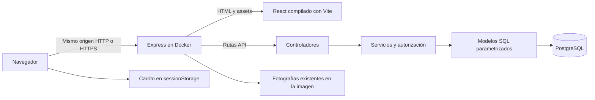

# EVA 3: arquitectura implementada

Referencia del código de `feature/fullstack-mvc`, revisada el 16-11-2026. Este documento describe la implementación; el estado efectivo de DEV/QA, las pruebas y las evidencias de la entrega se registran en [EVA3-estado-final.md](EVA3-estado-final.md). La topología AWS es una preparación futura descrita en [EVA3-AWS.md](EVA3-AWS.md), sin recursos creados ni validación remota.

## Flujo de la aplicación

Express sirve tanto el build React como `/api`. El frontend solicita rutas relativas con credenciales del mismo origen; no contiene un hostname RDS ni secretos. No existe una API de pedidos: el carrito pertenece al navegador y no persiste una orden en PostgreSQL.

## Capas y responsabilidades

| Capa | Archivos principales | Responsabilidad |
| --- | --- | --- |
| Presentación | `frontend/src/main.jsx`, `PublicApp.jsx`, `components/`, `admin/` | Carta, categorías, platos, destacados, carrito, autenticación, comentarios y formularios administrativos |
| Cliente HTTP | `frontend/src/api.js` | JSON, errores y cabecera `X-PNK-Request: 1` en escrituras |
| HTTP | `backend/src/app.js`, `routes/`, `controllers/` | Rutas, límites JSON, respuestas y traducción de errores |
| Negocio | `backend/src/services/` | Validación, composición del catálogo y alcance por restaurante |
| Persistencia | `backend/src/models/`, `config/database.js` | Consultas parametrizadas, pool PostgreSQL y transacciones |
| Evolución de esquema | `database/runner.js`, `migrations/` | Historial SHA-256, orden de migraciones y exclusión mediante advisory lock |
| Ejecución | `Dockerfile`, `compose.yaml`, `compose.production.yaml`, `scripts/stack.mjs` | Build, proceso sin root, entornos locales y manifiesto separado para DB externa |

Los nombres `restautantes` y `restautantes_id` se conservan para mantener la correspondencia con el esquema histórico. La capa administrativa publica además `restaurante_id` resuelto. No hay ORM, SQL construido con valores de entrada ni ejecución de PHP.

## React y recursos públicos

Vite genera `frontend/dist`. El contenedor final copia ese directorio y los recursos de `frontend/public`; Express entrega:

- `/`, `/carta/:id`, `/carrito/:id` y las páginas administrativas explícitas: el HTML de React.
- `/assets`: archivos generados con caché de un año e indicador `immutable`.
- `/static`: recursos históricos adaptados, con caché de una hora.
- `/api`: JSON. Una ruta desconocida termina en 404; no hay fallback general que oculte una API inexistente.

El diseño conserva recursos y estructura de pnkSecurity. Los scripts PHP y el directorio original `pnkSecurity` quedan fuera de la imagen; `.env`, SQL original, pruebas y documentación tampoco se publican como recursos HTTP. Vite de desarrollo usa 5173 y proxy local a DEV 3101; ese proxy no forma parte del despliegue productivo.

El carrito utiliza `pnk.cesta.v1.ID` en `sessionStorage`, con hasta 100 referencias de productos por restaurante. El precio y la disponibilidad visibles se obtienen del catálogo actual; no hay checkout, stock reservado, pago ni pedido servidor.

## Datos y migraciones

| Migración | Aporte |
| --- | --- |
| `001_initial_schema.sql` | Direcciones, restaurantes, cartas, categorías, items, usuarios y comentarios; FK y restricciones |
| `002_auth_sessions.sql` | Sesiones y contadores persistentes de intentos de acceso |
| `003_comments_user.sql` | Autor autenticado y fecha en comentarios, preservando datos anteriores |
| `004_admin_roles.sql` | Roles, asignaciones usuario/restaurante y disponibilidad de items |

El runner crea `schema_history`, normaliza CRLF a LF para el checksum y ejecuta cada archivo pendiente junto con su historial en una transacción. Un checksum distinto de un archivo ya aplicado detiene el proceso. La exclusión serializa runners, pero no transforma el conjunto completo en una sola transacción: una migración anterior puede haber terminado si una posterior falla.

Los seeds tienen historial independiente y son apropiados para la importación local acordada. No son parte del procedimiento de producción. Los siete restaurantes originales son datos conservados por la migración/importación; la API lista los restaurantes activos de PostgreSQL, sin fijar un total de siete en el código.

## Autenticación, roles y escrituras

Las contraseñas nuevas usan Argon2id. Una sesión contiene un token aleatorio de 32 bytes en la cookie `pnk_session`; PostgreSQL guarda sólo su SHA-256 y vencimiento de ocho horas. La cookie es `HttpOnly`, `SameSite=Lax`, `Path=/` y `Secure` cuando `APP_ENV=prod`. La aplicación no utiliza JWT ni una variable `SESSION_SECRET`.

La sesión vuelve a consultar estado, rol y asignaciones del usuario en cada solicitud. Desactivar una cuenta o cambiar su contraseña elimina sus sesiones. Los roles y permisos se verifican en Express; ocultar un formulario React no concede ni revoca acceso.

| Rol | Alcance |
| --- | --- |
| `CLIENTE` | Carta pública y, con sesión, comentarios; sin administración |
| `ADMIN_RESTAURANTE` | Restaurantes asignados y sus cartas, categorías y productos; sin alta de restaurantes ni gestión de usuarios |
| `ADMIN_GENERAL` | Todos los recursos administrativos y asignaciones de usuarios |

El servicio verifica tanto la relación actual como el destino de un cambio. Las escrituras administrativas usan aislamiento `SERIALIZABLE`, bloquean los registros pertinentes y vuelven a comprobar el actor dentro de la transacción. Los conflictos SQL previstos producen 409; el cliente debe actualizar y decidir si reintenta.

Las operaciones de escritura requieren `X-PNK-Request: 1`; si se recibe `Origin`, su host debe coincidir con `Host` y su protocolo debe ser HTTP o HTTPS. No hay CORS habilitado ni token CSRF independiente. Detrás de un proxy se debe conservar el host público para que esa comprobación siga funcionando.

La desactivación es lógica. No existen rutas DELETE ni borrado en cascada desde el panel. Desactivar un padre impide su publicación y la de sus descendientes mediante las consultas del catálogo; no reescribe automáticamente el estado de cada hijo. Las cifras administrativas cuentan el estado propio de cada recurso.

## Fotografías y escalamiento

La implementación asocia nombres/rutas a archivos JPG/JPEG, PNG o WebP ya existentes en `frontend/public/legacy/imagenes/codID/`. La validación comprueba pertenencia al restaurante, ruta real, firma inicial, extensión y tamaño máximo de 5 MiB. Rechaza URLs remotas, SVG, contenido inline y traversal. No hay recepción multipart, endpoint de upload, SDK S3 ni credenciales de almacenamiento.

Los archivos viajan con la imagen y todas las instancias futuras deben ejecutar el mismo digest para tener los mismos recursos. Para agregar archivos hoy se requiere una nueva imagen y validación; editar un contenedor individual produciría divergencias. Un servicio de subida a S3 compartido exigiría una nueva implementación y cambiaría el contrato actual que sólo admite archivos locales del restaurante.

Las sesiones y los intentos de acceso ya viven en PostgreSQL compartido, por lo que múltiples procesos Express pueden validar el mismo token sin afinidad de sesión en el ALB. El carrito continúa en el navegador. No hay escritura de archivos de usuario en disco local que deba sincronizarse. La caducidad se comprueba al leer; no está implementado un trabajo periódico para purgar sesiones vencidas e intentos antiguos.

## Operación y límites

La imagen usa Node 24 Alpine, build de Vite separado, dependencias de ejecución con `npm ci --omit=dev` y usuario `node`. El servidor escucha en `0.0.0.0` y atiende SIGTERM/SIGINT cerrando HTTP/pool, con plazo de diez segundos.

`GET /api/health` consulta `SELECT 1`: devuelve 200 con DB disponible o 503 sin ella. Es una comprobación de conexión, no de integridad de datos, de migraciones aplicadas ni de todas las funciones del CRUD. Docker la ejecuta cada 15 segundos; no existe un endpoint separado de liveness ni un supervisor de contenedores implementado para AWS.

El pool está fijado a diez conexiones por proceso, conexión en tres segundos, inactividad en treinta segundos y límites de consultas de cinco/seis segundos. Estos valores no tienen variables propias. El máximo del futuro Auto Scaling debe presupuestar conexiones de todos los procesos, migraciones y operación.

`compose.yaml` es local: PostgreSQL 17 en volumen nombrado, puertos publicados sólo en loopback y backend dependiente de DB/migración. Fija `DB_SSL=disable` y el host `db`; no conecta a RDS. Tras exigir TLS en `APP_ENV=prod`, tampoco constituye por sí solo un entorno PROD compatible. No debe ejecutarse como manifiesto AWS ni usarse para reemplazar DEV sin cumplir sus resguardos.

`compose.production.yaml` prepara únicamente backend y migrador opcional con una imagen ya construida, DB externa/TLS y CA montada. No construye imagen, crea DB ni ejecuta migraciones al iniciar el backend. Usa filesystem de sólo lectura, `/tmp` temporal y publicación loopback por defecto; para ALB se deberá elegir explícitamente la IP privada y protegerla con SG. `scripts/stack.mjs up prod` está bloqueado para evitar iniciar el PostgreSQL local sin TLS. Este manifiesto sigue pendiente de ejecución y validación con RDS/EC2.

La API fija `Cache-Control: no-store` al entrar a su router. Los mensajes de error evitan publicar consultas, hashes o credenciales. Todavía no hay logging estructurado de solicitudes, identificadores de correlación, envío a CloudWatch, políticas IAM, manifiesto EC2/ASG ni configuración de Cloudflare. Tampoco hay configuración de `trust proxy`: detrás de ALB `req.ip` identifica al proxy y afecta la clave del bloqueo de login. [La guía oficial de Express](https://expressjs.com/en/guide/behind-proxies/) explica por qué debe definirse la confianza según la cadena real de proxies antes de interpretar IPs reenviadas.

Contrato completo de rutas y validaciones: [EVA3-api.md](EVA3-api.md). Preparación y decisiones pendientes de producción: [EVA3-AWS.md](EVA3-AWS.md).
